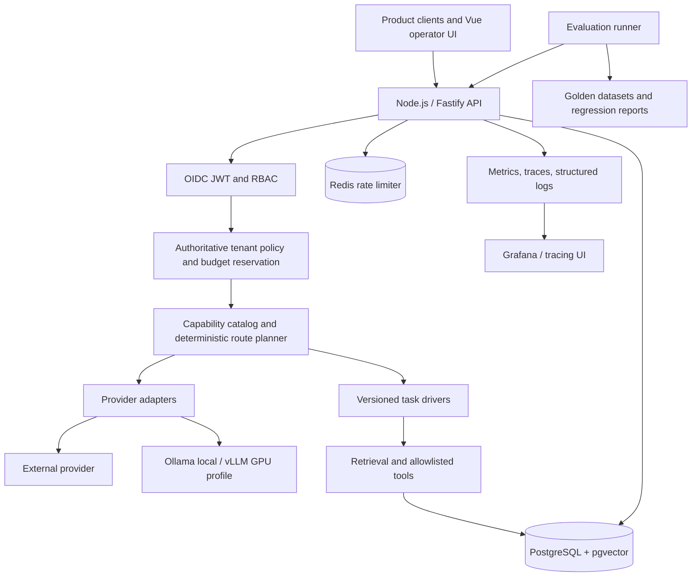
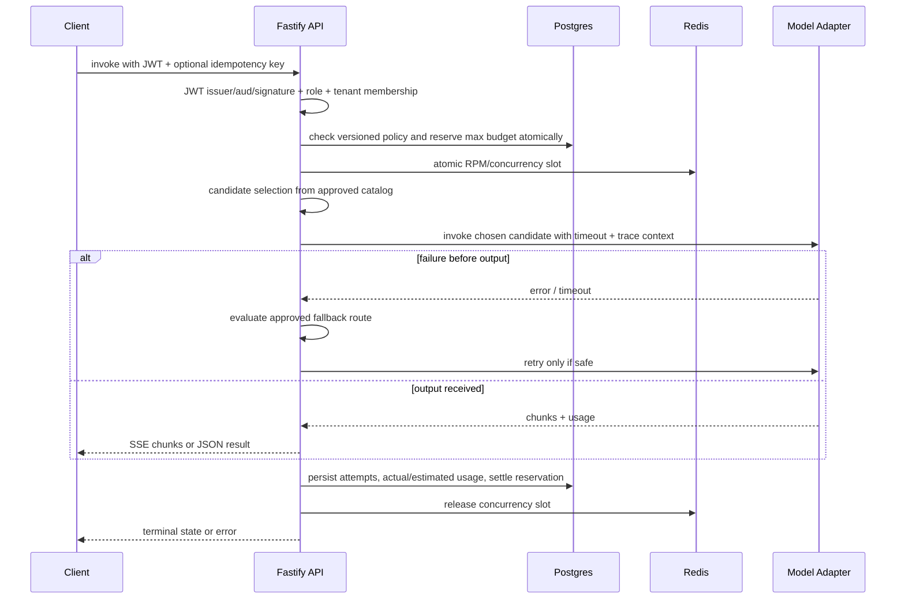

# Governed Inference Lab

**Status:** research and implementation plan only. No application source code or GitHub repository has been created.

A portfolio-grade, deliberately scoped implementation of a multi-tenant LLM inference and agent-driver platform. It is inspired by the *publicly described* Mekari AI Builder responsibilities, **not** by access to Mekari's systems, internal architecture, secrets, or customer information.

**Core thesis:** an HTTP 200 from a model does not prove that a business task succeeded. The system must account for policy, task quality, reliability, latency, and cost *per successful task*.

## Five-day target

A reviewer can start the system locally, sign in as two fictional tenants, invoke one versioned driver through a governed REST/streaming API, observe provider selection and usage costs, demonstrate a denied cross-tenant attempt, reproduce a provider failure, evaluate task-quality differences, and inspect an operations dashboard. Use a real local Ollama model (or an explicitly configured external provider) for the real inference path; deterministic simulators are for tests only.

**Not a claim of production readiness.** Kubernetes, GPU-based vLLM deployment, commercial-grade availability, large-scale metering, fine-tuning, and hundreds-of-tenants load are extensions requiring infrastructure, sustained testing, and operators.

## Read in order

1. [`docs/01-requirements-and-scope.md`](docs/01-requirements-and-scope.md) — requirement traceability, business scenario, MVP limits.
2. [`docs/02-architecture.md`](docs/02-architecture.md) — system architecture, control/data plane, routing, security, ledgers, design decisions.
3. [`docs/03-api-and-data-contracts.md`](docs/03-api-and-data-contracts.md) — API contracts, schema, invariants, event streaming, database migration plan.
4. [`docs/04-evaluation-and-testing.md`](docs/04-evaluation-and-testing.md) — datasets, scoring, attack cases, load plan, release gates.
5. [`docs/05-five-day-execution.md`](docs/05-five-day-execution.md) — small sequential build slices, tasks, dependencies, daily checkpoints.
6. [`docs/06-operations-and-security.md`](docs/06-operations-and-security.md) — local operations, alerts, incidents, cost constraints, rollout/rollback.
7. [`docs/07-research-and-tradeoffs.md`](docs/07-research-and-tradeoffs.md) — source URLs, alternatives, honest skill/production gaps.
8. [`contracts/openapi.yaml`](contracts/openapi.yaml) — starting public contract **to be refined before implementation**.
9. [`docs/08-repository-bootstrap.md`](docs/08-repository-bootstrap.md) — repo structure and coding-agent handoff for later.
10. [`AGENTS.md`](AGENTS.md) — coding-agent instructions for the future repository.

## High-level architecture



## Technology picks

- **Core API:** Node.js 24 LTS, TypeScript strict, Fastify, Zod, PostgreSQL, Kysely + explicit SQL migrations, OpenAPI.
- **Authentication:** Keycloak for local OIDC / OAuth2, bearer-JWT validation against issuer JWKS, app-level membership and roles; human dashboard uses authorization code + PKCE.
- **Capacity and ledger:** PostgreSQL transactionally authoritative; Redis for distributed rate limiting (fail closed when unavailable).
- **Model connections:** typed adapters for one hosted provider and a local OpenAI-compatible endpoint (Ollama); optional GPU vLLM.
- **AI drivers:** versioned JSON schema + explicit steps (no opaque, unconstrained agent loop), pgvector for small RAG corpus, allowlisted read-only tools.
- **UI:** Vue 3 + Vite + TypeScript; charts from metrics returned by our API.
- **Testing:** Vitest, Testcontainers or Compose integration tests, Playwright, k6, deterministic provider simulator + golden fixtures.
- **Observability:** OpenTelemetry traces, Prometheus metrics, Grafana panels, JSON logs with payload redaction.
- **Deployment:** Docker Compose MVP; optional k3d/Helm demonstration, **not** a production GPU-serving claim.

## Priority policy

**P0:** tenant boundary, budget correctness, versioned driver, real inference, deterministic eval, test evidence.
**P1:** Vue dashboard, metrics/traces, failure injection, CI, deploy/runbooks.
**P2 (stretch):** live GPU vLLM, Kubernetes/Helm deployment, Go service, provider batch/file/multimodal APIs, sophisticated scheduler, fine-tuning.

No publicly exposed inference endpoint until auth, budgets, credential handling, and basic abuse protections are implemented and tested.

---

# 01 — Product requirements, target user and scope

## Problem statement

Multiple SaaS product teams want to call different LLMs without integrating every provider separately. They need a stable contract with authenticated tenant boundaries, allowed models, budgets, accurate usage, observable failures, versioned task behavior, and evidence that a task succeeded. This is a prototype of those capabilities with **fictional** business data.

## Public job-description interpretation

Source: public AI Builder listings reproduced by LinkedIn, independent job listings and Mekari career page (see `07-research-and-tradeoffs.md`). The recruiting link can change and was not directly retrievable during research. Do not claim that this blueprint is Mekari's actual internal design.

| Public role requirement | Planned evidence | Phase | Honest boundary |
|---|---|---|---|
| Secure REST and streaming request path | `POST /v1/infer`, SSE, contract tests | P0 | Single-region lab |
| OAuth2, RBAC, tenant isolation | OIDC/JWKS, membership checks, RLS, two tenant fixtures | P0 | Only tested locally |
| Policy, quota, metering | DB reservation/finalization, Redis RPM, immutable ledger | P0 | Price estimates not invoices |
| Model providers and self-hosted models | Hosted adapter + Ollama OpenAI-compat; vLLM adapter profile | P0/P2 | Ollama != production GPU serving |
| Capability routing and fallback | Versioned model registry, hard policy eligibility, deterministic cost/quality choice | P0 | No opaque AI router |
| Retrieval, agents, tools | One classification driver and one cited knowledge QA driver | P0 | No unbounded autonomous execution |
| Eval datasets and release gates | Golden cases, outcome scores, canary simulation, rollback | P0/P1 | Quality figures must be measured |
| Quality/latency/cost economics | TTFT, token/cost ledger, cost per successful task | P0/P1 | No fabricated speed claims |
| Operator control surfaces | Vue console with policies, attempts, per-task usage, driver versions | P1 | No enterprise UX polish claim |
| Alerts/runbooks/incident handling | Trace propagation, threshold alerts, failure injection/runbook | P1 | Short synthetic incident |
| PostgreSQL indexing/transactions | SQL schema, `FOR UPDATE`, `EXPLAIN ANALYZE` note | P0 | Modest dataset |
| Docker/Kubernetes/Helm, Go | Compose MVP; Helm/Go optional exercises | P1/P2 | Not misrepresented as production experience |
| Multimodal, provider file and batch APIs, fine-tuning | documented extensions, no fake implementation | P2 | Not in 5-day MVP |

## Personas

- **Product engineer:** integrate using one API contract and an approved driver version.
- **Tenant admin:** view usage and request budget, but cannot access another tenant's data.
- **Platform operator:** edit versioned policy and rollout percentages; investigate a request through traces and ledger records.
- **AI engineer:** compare candidate model/driver behavior against fixed test cases, then promote/rollback.

## Concrete fictional business use case

Two test businesses: `tenant-nusa` (fictional HR support organization) and `tenant-mentari` (fictional finance SaaS support organization).

**Driver A: `support-triage@1.0.0`** accepts a synthetic Indonesian or English support ticket and emits JSON:
`{category, priority, should_escalate, summary, reason_codes}`. Labels have clearly defined rubric and gold answers. The driver can perform one read-only lookup of a fictional ticket account's entitlement from a fixed fixture; validate its arguments and output.

**Driver B: `policy-qa@1.0.0`** answers questions from tenant-specific, synthetic policy docs; it must cite permitted document IDs and abstain when evidence is missing. Use pgvector for embeddings, and exact/keyword retrieval fallback. It must never return the other business's document content.

These are NOT Mekari/Jurnal/Talenta customer data. Do not use scraped HR/payroll personal data or proprietary docs.

## In-scope workflow

1. Product client logs in / uses its assigned client identity with explicit tenant membership.
2. Invoke an approved driver/model; API authenticates and authorizes.
3. Check tenant restrictions, request limits and budget **before** dispatch.
4. Select an eligible provider/model based on capability, approved dataset quality gate, latency SLO and predicted cost; reserve sufficient capacity/budget.
5. Perform an actual local or configured remote inference and validate output; stream when requested.
6. Finalize usage/attempt/ledger on success, timeout, provider error or client disconnect.
7. Make request-level history and aggregated redacted telemetry visible to authorized operators.
8. Run offline eval; compare to pinned baseline, stage new driver/version and safely roll back.

## Explicit non-goals for five days

- Replicating Mekari systems or processing real Mekari/customer datasets.
- Production-scale high availability, multi-region/GPU cluster scheduling, real payment billing or external public signup.
- Building a new language model or claiming model fine-tuning. The role allows task-specific capabilities via prompts/retrieval/tools/validation as well.
- Training on private team prompts or storing raw confidential input in observability systems.
- Native provider multimodal, batch, and file APIs. Document interface seams only.
- Supporting all OpenAI wire semantics: the primary API is our own explicit contract; any compatibility endpoint must pass its own contract tests.

## Acceptance-level demonstration

A 6-minute scripted walkthrough must show: tenant A allowed call; tenant B receives 403/zero tenant-A data; quota/budget exhaustion returns 429/402-style domain code without provider call; model A fails before first token and deterministic fallback to model B; real Ollama request; versioned support-triage output; policy-qa with valid tenant citations; eval result table; operator UI with time-to-first-token and approximate cost; release rollback. If time is limited, reduce UI polish, not integrity of the request path.

---

# 02 — Architecture and design decisions

## Design priorities

1. **Govern first.** No provider request without a verified principal, tenant membership, policy, and budget reservation.
2. **Task-level outcomes.** Choose eligible backends by acceptance-gated task quality and total cost per successful task, not cheapest tokens alone.
3. **Simple services until compelled.** Modular monolith Fastify app plus Postgres/Redis and optional isolated inference process. A queue of microservices adds failure modes the MVP does not need.
4. **Failure as a first-class state.** Every attempt terminates in an explicit, queryable state; SSE does not silently conceal faults.
5. **Make claims falsifiable.** Every important dashboard claim traces to a stored measurement or a reproducible test.

## Components

**Core (Node/Fastify):** REST/SSE ingress, JWT issuer/audience validation, roles, tenant lookup, schema validation, policy compiler, atomic reservations, route planner, provider adapters, driver interpreter, ledger writer, tracing, metrics.

**Postgres:** authenticated application data; versioned model/provider capabilities; immutable price snapshots; tenant policies; member roles; driver manifests; attempt/usage ledger; retrieval documents and embeddings; evaluation run metadata.

**Redis:** distributed RPM/concurrent-request limiter using atomic script or a proven library; user-visible budget remains transactional in Postgres. On unavailable Redis, **reject cost-bearing operations** rather than assume unlimited capacity; internal health unaffected.

**Keycloak:** local identity issuer, OIDC for browsers (code + PKCE) and client credentials for service clients. Keycloak realm is NOT our application's tenant partition; membership is authoritative in Postgres. Token `tenant` headers or claims alone are not accepted without membership checks. Pin a reviewed local image version before building.

**Model adapters:** `ProviderAdapter` normalizes messages, chunks, tool calls, token usage, errors and cancellation. One hosted API route (provider configurable using secrets) and a local Ollama OpenAI-compatible adapter are the MVP. vLLM is a separate GPU-only deployment profile using its actual OpenAI-compatible endpoints. An adapter must declare capabilities; OpenAI compatibility is incomplete across products.

**Driver engine:** an explicit bounded DAG/step list (prompt -> tool/retrieval -> model -> schema validation -> result) with max steps, max wall time, max token/cost, allowlisted read-only tools and argument schemas. No arbitrary generated code execution or network URLs from a prompt.

**Frontend:** Vue 3 dashboard with authenticated session, tenant picker restricted to memberships, models/versions, usage, live route attempts and synthetic eval runs. Operators may stage/pin/rollback driver versions through RBAC; product users are read-only.

## Request data-plane sequence



## Routing algorithm (transparent, deterministic)

Inputs: verified `tenant_id`, `driver_id@version`, task class, allowed data residency, requested capabilities, policy limits, request max tokens, deadline, benchmark-approved model candidates, current provider health and posted prices.

1. Exclude unauthorized providers, capabilities that do not meet the task (streaming/tools/JSON), disallowed data handling, retired versions and quality-below-gate candidates.
2. Exclude over-budget routes using conservative worst-case reservation; reject if none fits. Do not downgrade task quality silently to save cost.
3. Score remaining models based on **observed** task success rate and completion cost, with latency threshold a hard gate when specified. No unconstrained LLM-as-router in MVP.
4. Choose stable tie-break by registry priority / model ID for reproducibility.
5. Capture `policy_version`, `price_version`, `route_decision`, selected model and fallback ordering in each attempt record.
6. If the provider fails **before first output** and replay is allowed, release/recompute candidate reservation safely and try the next approved provider once. For a streamed partial response, **do not** splice another provider's text into the same answer; emit a terminal error event and charge for consumed usage if reported.
7. Record quality offline per dataset and periodically refresh routing eligibility via review, not by self-promoting production results without evidence.

For first prototype, use eligible-cheapest-with-quality-gate rather than build an overfitted predictor. Compare to pinned `always-safe-baseline` in eval output.

## Atomic cost budget and ledger

**Invariant:** a request cannot consume unreserved budget; every finalized attempt has exactly one charge settlement; costs use integer micro-USD (or decimal) not floating-point dollars.

- Begin DB transaction; resolve tenant and policy; `SELECT ... FOR UPDATE` relevant tenant budget row; enforce `spent + active_reserved + proposed_reservation <= limit`, plus projected token cap; create reservation and request row; commit before network request.
- Redis rate/concurrency slot is separate; whichever reservation succeeds first must be released if the other fails.
- Each downstream attempt stores provider ID, model version, price snapshot, externally reported token counts and whether tokens are exact/reported/estimated. Streaming provider usage may only be available at final chunk; classify missing usage as estimated, not zero.
- On finalization, use a transaction with unique `(tenant_id, request_id, attempt_no)` and a unique settlement ID; move reservation to final actual charge exactly once; timeout/disconnect retains any observed consumed usage and reconciles unknowns conservatively (never silently marks free).
- A background reconciliation job is a post-MVP follow-up to find stuck reservations and query provider receipts where possible; day-five includes a deterministic stale-reservation repair command plus explicit audit trail.
- Idempotency is scoped to tenant+key+request body hash. Identical completed non-streaming calls return saved result without an extra model call/charge; in-flight duplicates get 409. Streaming reattach is unsupported in MVP and explicitly rejected.
- Native paid invoicing/billing is out of scope. API shows `estimated_cost_micro_usd` with provenance.

## OAuth and tenant isolation

- Verify signed JWT using configured issuer JWKS and allowed audience; reject unsigned, expired, wrong-issuer, wrong-audience tokens. Do not accept arbitrary `X-Tenant-ID` as authority.
- User/session may choose one of *database-verified* memberships. Service account client identity maps to a pre-registered membership and scoped abilities. Admin operators have an explicit separate RBAC role.
- Apply PostgreSQL RLS to tenant-owned tables; set the active tenant as a **transaction-local** setting on the DB connection within a transaction, and use a DB role without `BYPASSRLS`. Avoid ORM calls outside that transaction context for protected tables. Require/force policies where applicable. Run negative isolation tests as the actual app DB role.
- Scope vector retrieval by tenant at query time and under RLS; for this small dataset exact distance search with a tenant B-tree index is sufficient. HNSW shared indexes need careful tenant filtering and recall assessment, so defer indexing to measured need.
- Authentication/authorization failure must produce no model invocation and no leakage in telemetry.

## SSE and cancellation rules

- On `POST /v1/infer` with `stream:true`, send `text/event-stream` with events `meta`, `delta`, `usage`, `done`, `error`. `meta` includes safe request ID and chosen model alias, not provider credentials. `done` is emitted only once after successful validation and persistence.
- Support client `AbortSignal`, provider timeout, server graceful stop. A disconnect cancels upstream if possible, updates ledger, and releases slots/reservation.
- Backpressure: do not buffer unbounded chunks; apply high-water marks. If client is too slow, cancel and mark termination.
- If final structured JSON validation fails, the custom API does NOT emit `done:success`; it records `task_failed_validation` even when provider HTTP status was 200.
- Any future OpenAI-compatible endpoint needs separate chunk/response schema tests; never label custom SSE as OpenAI compatible.

## Design decisions / ADRs

**ADR-001 Modular monolith vs microservices:** monolith selected to reduce coordination overhead and make transactional budget checks tractable. Separate model processes remain independent endpoints.

**ADR-002 Direct adapter boundary vs putting LiteLLM in front:** write a small adapter layer to demonstrate core engineering decisions. LiteLLM can be optionally run as a comparison/reference or alternative, but installing a ready-made proxy is not evidence of owning routing, budget correctness and tenancy. Its budget reservation semantics should be studied, not copied blindly.

**ADR-003 Keycloak vs homegrown auth:** existing OIDC server reduces authentication mistakes and permits real PKCE/service credentials; app still must enforce membership/RBAC.

**ADR-004 Local Ollama vs vLLM:** Ollama provides a real CPU-friendly local inference path on ordinary dev hardware. vLLM only under verified CUDA/GPU capability; its performance claims must be benchmarked separately.

**ADR-005 pgvector vs separate vector DB:** colocating tiny synthetic embeddings with policy docs minimizes systems and helps tenant consistency. Benchmark before adding ANN.

**ADR-006 Full multi-agent framework vs explicit workflow:** a bounded, inspectable workflow has fewer unsafe surprises and clearer evaluation attribution than unbounded autonomous agents.

---

# 03 — API, types, data model, and invariants

## API overview

Base `/v1`. All tenant-scoped endpoints require OIDC access token with valid `iss`, `aud`, `exp` and application membership. Admin endpoints require `platform.operator`; tenant-admin endpoints require tenant role `tenant.admin` scoped to selected membership.

| Method and route | Intent | P |
|---|---|---|
| `GET /health/live` | process liveness, no secrets | 0 |
| `GET /health/ready` | dependencies policy; may return 503 | 0 |
| `GET /v1/models` | tenant-allowed models, capabilities and current version | 0 |
| `GET /v1/drivers` | approved tenant-allowed driver versions | 0 |
| `POST /v1/infer` | generic model or driver execution; JSON/SSE | 0 |
| `POST /v1/drivers/{driverId}/invoke` | explicit driver invocation alias; version required | 0 |
| `GET /v1/requests/{requestId}` | own-tenant request history, redacted | 0 |
| `GET /v1/usage?from=...&to=...` | aggregates by driver, model and tenant | 1 |
| `GET /v1/admin/policies` | scoped operator policy versions | 1 |
| `POST /v1/admin/releases` | stage version to configurable percentage | 1 |
| `POST /v1/admin/releases/{releaseId}/rollback` | restore previously approved version | 1 |
| `POST /v1/evaluation-runs` | trigger dataset run in controlled environment | 1 |

**Request example:**

```json
{
  "tenant_id": "tenant-nusa",
  "driver": {"id": "support-triage", "version": "1.0.0"},
  "input": {"ticket_text": "Saya tidak bisa masuk ke aplikasi...", "customer_ref": "synthetic-041"},
  "stream": false,
  "constraints": {"max_output_tokens": 220, "timeout_ms": 15000}
}
```

`tenant_id` is a *selector* only, NEVER authorization. The JWT principal must have verified membership; server resolves the authoritative tenant context. For service accounts, only preapproved tenant IDs may be selected.

**Response example:**

```json
{
  "request_id": "req_7e8e43",
  "status": "completed",
  "driver": "support-triage@1.0.0",
  "route": {"public_model_alias": "local-small", "policy_version": "policy-4"},
  "result": {"category": "login", "priority": "medium", "should_escalate": false, "summary": "...", "reason_codes": ["LOGIN_FAILURE"]},
  "usage": {"input_tokens": 101, "output_tokens": 41, "source": "provider_reported", "estimated_cost_micro_usd": 0}
}
```

0 micro-USD is allowed **only for explicitly configured price=0 local models**; not a stand-in for unreported paid tokens. Use separate accounting for hardware cost, if known; otherwise local GPU/CPU infrastructure cost is **not included** in measured provider cost.

**SSE:** `event: meta`, `event: delta`, `event: usage`, `event: done` or `event: error`, with serialized JSON `data:` lines and a final blank line. The client must distinguish a provider stream's apparent termination from verified successful completion; `event: done` only after output/schema validation and ledger persistence. Mid-stream errors are terminal, never silently re-routed. Include request ID in `meta`; no raw prompt in telemetry. Resume unsupported.

**Machine-readable starting contract:** [`../contracts/openapi.yaml`](../contracts/openapi.yaml). It sketches the surface; include OpenAPI contract tests before treating it as stable.

## Provider adapter interface (design only)

```ts
interface ProviderAdapter {
  id: string;
  capabilities(): Promise<CapabilityManifest>;
  invoke(request: NormalizedInferenceRequest, signal: AbortSignal): Promise<NormalizedResult>;
  stream?(request: NormalizedInferenceRequest, signal: AbortSignal): AsyncIterable<NormalizedEvent>;
  health(): Promise<ProviderHealth>;
}

type NormalizedEvent =
  | { type: 'token'; text: string }
  | { type: 'tool_call'; name: string; arguments: unknown }
  | { type: 'usage'; inputTokens?: number; outputTokens?: number; source: 'reported'|'estimated' }
  | { type: 'provider_error'; code: string; retryable: boolean };
```

Strict normalization prevents a provider-specific `finish_reason`, usage count, tool format or failed chunk from silently affecting cost and validation. Record raw provider result only in an *explicit opt-in debug session with synthetic data*, never the normal logs.

## Driver manifest (design only)

```yaml
id: support-triage
version: 1.0.0
owner: lab-ai
input_schema: schemas/support-triage.input.schema.json
output_schema: schemas/support-triage.output.schema.json
allowed_capabilities: [structured_output, tool_calling]
allowed_tools: [lookup_synthetic_entitlement]
max_steps: 3
max_output_tokens: 220
max_runtime_ms: 15000
baseline_dataset: datasets/support-triage-v1.jsonl
release_gates: [schema_validity, rubric_accuracy, cross_tenant_isolation]
```

Driver version immutably pins manifest, prompt template, tool definitions, retrieval config, and evaluation baseline reference. Editing a prompt means publishing `1.0.1` or `1.1.0`, never mutating a supposedly immutable release version.

## Data model

**Core tenant and identities:** `tenants(id, name, enabled)`, `principals(id, oidc_subject, issuer)`, `tenant_memberships(tenant_id, principal_id, role)`, `service_clients(...)`, `tenant_policies(id, tenant_id, version, allowed_capabilities, allowed_providers, residency, budget...)`.

**Model routing:** `model_catalog(id, provider_id, alias, model_name, model_revision, capabilities_json, context_limit, status)`, `model_price_versions(id, model_id, valid_from, input_micro_usd_per_million, output_micro_usd_per_million, provenance)`, `model_evaluation_gates(driver_id, driver_version, model_id, dataset_version, passed, result_digest)`, `routes(id, policy_version, model_id, priority)`.

**Drivers/RAG:** `driver_versions(driver_id, version, manifest_json, prompt_digest, published_at, owner, status)`, `knowledge_documents(id, tenant_id, title, source_type, checksum)`, `knowledge_chunks(id, tenant_id, document_id, text, embedding, embedding_model_version)`, `driver_releases(id, driver_id, pinned_version, rollout_percent, effective_at)`.

**Requests/accounting:** `inference_requests(id, tenant_id, principal_id, driver_id, driver_version, body_hash, idempotency_key, state, created_at, finished_at, trace_id)`, `inference_attempts(request_id, ordinal, provider_id, model_id, started_at, first_token_at, finished_at, termination_reason, usage_source, input_tokens, output_tokens, price_version_id)`, `budget_accounts(tenant_id, month, budget_micro_usd, spent_micro_usd, reserved_micro_usd)`, `budget_reservations(id, tenant_id, request_id, max_micro_usd, state)`, `usage_settlements(id, tenant_id, request_id, reservation_id, charged_micro_usd, unique_settlement_key, created_at)`.

**Evaluation/release:** `datasets(id, version, digest, protected_scope)`, `evaluation_runs(id, dataset_digest, driver_version, model_revision, evaluator_version, started_at, status, artifacts_uri)`, `evaluation_scores(run_id, example_id, metric, result, provenance)`, `audit_events(id, actor_id, tenant_id, operation, before_digest, after_digest, timestamp)`.

### Migrations and constraints

- Include a migration per schema step with reversible procedure where safe; never delete tenant data in `down` as a demo shortcut.
- Foreign keys include `tenant_id` for joined tenant-owned records; unique `(tenant_id, idempotency_key)` and body-hash handling; unique `(request_id, ordinal)` and settlement key.
- Check constraints for nonnegative budgets, `spent >= 0`, `reserved >= 0`, `rollout_percent BETWEEN 0 AND 100`.
- B-tree `(tenant_id, created_at DESC)` on requests/attempts; `(tenant_id, document_id)` on chunks; `(tenant_id, driver_id, version)` on driver approvals. Measure with `EXPLAIN (ANALYZE, BUFFERS)` before more indexes.
- On tenant-owned tables, RLS policy references transaction-local tenant setting and forbids missing setting. Application DB role must not own tables or bypass RLS. Test negative access for `SELECT`, `UPDATE`, `DELETE`, `INSERT`, joins and vector retrieval.
- Avoid reliance on `SELECT` then `UPDATE` without locking; budget reserve is transactional and concurrency-tested at 10–50 simultaneous requests.

## Authentication, status and error codes

- `401 UNAUTHENTICATED`: missing/invalid bearer token.
- `403 TENANT_FORBIDDEN`: token valid but not a member/authorized role.
- `422 INVALID_CONTRACT`: Zod/JSON schema failure.
- `429 RATE_LIMITED` or `QUOTA_EXCEEDED`: RPM/concurrency/allowance exhaustion, include safe `Retry-After` where relevant.
- `409 IDEMPOTENCY_CONFLICT`: same idempotency key with mismatched body, or stream already in progress.
- `409 DRIVER_NOT_APPROVED`: version not approved for tenant.
- `503 PROVIDERS_UNAVAILABLE`: all authorized eligible providers unavailable, with no degraded unsafe route.
- `504 MODEL_TIMEOUT`: provider timeout; terminal attempt recorded.
- `200` with `status=task_failed_validation` SHOULD NOT be returned as a valid successful task; prefer typed non-2xx for non-streaming task-contract failure.

## Invariants we will explicitly test

1. No unauthorized token can call a provider.
2. No request can access another tenant's usage, policy, documents, embeddings, or secrets.
3. Concurrent budget reservation never exceeds its hard ceiling.
4. Rate limit failure and upstream cancellation always release the other acquired resources.
5. A request is charged at most once; retry and duplicate request identity do not double-charge.
6. Response usage `source` reflects whether real provider counts were received or estimated.
7. Mid-stream provider failures cannot masquerade as successful output.
8. Every route records policy, driver, model and price version used.
9. No output is called successful before task schema/required evidence validation.
10. Rollbacks restore prior immutable driver/version references without corrupting in-flight requests.

---

# 04 — Evaluation, reliability tests and performance evidence

## Evaluation is a product feature

The decisive metric is **task success at acceptable policy, latency and cost**. A 200 response from the provider is an infrastructure observation, not a task-quality verdict. A valid answer with the wrong category, invented citation, or unsafe tool action is a task failure.

### Evaluation assets (all synthetic / licensed)

- `support-triage-v1.jsonl`: **minimum 40** varied, labeled synthetic tickets in Indonesian and English. Strata: login/account access, invoice/billing, feature questions, outages, privacy/security escalation, ambiguous cases, and benign out-of-domain questions. Distinct expected category, priority, escalation and reason codes. Reserve a held-out set not consulted while tuning prompts.
- `policy-qa-v1.jsonl`: **minimum 25** questions about two completely synthetic tenant KBs; 15 answerable with exact document IDs and 10 deliberately unanswerable or cross-tenant traps. Gold: required citation IDs or required abstention.
- `security-cases.jsonl`: **minimum 20** adversarial cases: cross-tenant API requests, forged header, prompt injection in retrieved chunk, malformed tool arguments, exfiltration instruction, invalid JWT, expired JWT, oversized requests and unsafe URL/command patterns.
- `provider-fixtures/`: deterministic response emulator with controllable timeouts, 429/5xx, delayed first token, malformed chunks, missing usage, interrupted stream, client cancellation and two simultaneous retries.
- `routing-matrix.yaml`: declared tenant/provider capabilities, policy budgets, measured quality pass/fail status, price snapshots and deterministic expected route for each fixture.

Do not train the prompt against every evaluation label. Version dataset digests and track which tests are hidden/held out.

### Scoring rubric

**Task triage:** JSON schema valid; `category` exact match; escalation sensitivity for security/outage; priority match; reason codes match approved rubric. Report each separately, not one easy-to-game aggregate.

**Policy QA:** citation validity (`citation_id` exists and belongs to tenant); evidence coverage; answer correctness via deterministic references/manual annotation; abstention when no evidence. Never treat fluent prose as proof. Document the human annotation process. Avoid using an LLM judge as the sole release gate.

**Operational correctness:** auth/tenant negative tests, disallowed provider requests=0, quota oversubscription=0, duplicate billing=0, success-after-stream-error=0, stuck reservations tracked/repairable=100% in synthetic fault tests.

**Economics:** `cost_per_successful_task = SUM(actual_or_estimated_provider_cost_for_all_attempts) / number_of_golden_tasks_that_met_task_acceptance`, labeled by version/dataset/model/provider. If denominator zero, report undefined, never $0. Include retry costs, failures and tool costs when known. Provider list prices are a versioned snapshot; local CPU/GPU server cost must be reported separately or as unmeasured.

**Latency:** request p50/p95; TTFT p50/p95 for successful streamed responses; tokens/sec for models that report token counts; provider timeout rates; end-to-end completed task time; queue wait if self-hosted serving exposes it.

### Release gates — planned targets, not achieved results

| Gate | Prototype release target | Interpretation |
|---|---|---|
| Auth / cross-tenant negative tests | 100% pass; 0 tenant leakage | Mandatory, blocking |
| Concurrent budget and settlement tests | 0 overshoots / double-settlements in tested load | Mandatory, blocking |
| Response schema validity | >= 98% on held-out triage set | Proposed target only |
| Triage category accuracy | >= 85% overall; no ignored critical-case slice | Proposed, revise based on baseline |
| Required security escalation | 100% for curated critical synthetic cases | Blocking |
| QA cross-tenant citation leaks | 0 in adversarial set | Blocking |
| QA valid citations and abstention | >= 90% of labeled cases | Proposed target only |
| New driver vs baseline | No unacceptable slice regressions; publish both scorecards | Blocking relative check |
| p95 latency under test load | Record measured value and context; no invented global SLO | Evidence needed |
| Cost per successful task | Demonstrated comparable on same dataset and traffic mix | Evidence needed |

If the local model misses a quality gate, **record the miss** and either route only to a better approved model or disable that driver/model pairing. Do not lower quality gates to force a celebratory launch.

### Benchmark matrix

| Case | Prompt size | Output size | Concurrency | Simulated/networked? |
|---|---:|---:|---:|---|
| Short classification | ~200 tokens | ~80 | 1, 5, 20 | Both, separately labeled |
| Typical policy QA | ~1k tokens | ~200 | 1, 5, 10 | Both |
| Long-context retrieval | ~4k tokens | ~500 | 1, 5 | Real profile if hardware allows |
| Upstream timeout | any | no output | 10 | Deterministic fixture |
| Provider 429/5xx | any | no output | 10 | Deterministic fixture |
| Stream interruption | ~200 | partial | 5 | Fixture and one real cancellation |
| Quota race | any | N/A | 20–50 | Postgres/Redis integration test |

Use k6 arrival-rate and fixed VU scenarios, record environment CPU/RAM/GPU, model sizes/quantization, tokens, warm vs cold load, provider/network, request mix and date. Separate fake backend overhead measurements from real model serving measurements. k6 thresholds can enforce pass/fail criteria; Grafana documentation covers scenarios and thresholds.

### Required experiments

**Exp-01 Routing economics:** fixed quality-approved baseline model vs lower-cost candidate. Report accuracy, cost per success, p95 latency, number of retries, policy rejects, model revisions and dataset hashes. If quality is unacceptably different, there is no winner.

**Exp-02 Local vs provider:** same synthetic prompts and acceptance criteria; include local hardware/cold start; label local cost as token-provider fee 0 but hardware/electricity unknown—not 'free inference'.

**Exp-03 Versioned driver:** prompt-v1 vs prompt-v2 with identical routing model and test data. Fail the gate on critical regression; record candidate and baseline output diffs.

**Exp-04 Tenant leakage:** use two tenants with overlapping document titles and different content, verify never returns other tenant citations under requests, joins, admin views, vector search and streaming metadata.

**Exp-05 Fault injection:** inject provider 429/5xx, unavailable Redis, unavailable Postgres, missing reported usage, pre-token failure, post-token failure and premature client disconnect. Assert final ledger states and successful cleanup.

### Testing strategy

- Unit tests: route eligibility, scoring tie-breaks, token/cost arithmetic, PII log scrubbing, Zod schemas, driver step budget, fallback decisions.
- DB integration tests: RLS using runtime DB role, serializable/locked budget reservations, settlement idempotence, migration reversibility and SQL index explain note.
- API contract: OpenAPI schemas, 401/403, 429, 422, deterministic SSE frames and disconnect handling.
- Adapter contract: mock provider implementing every normalized status/usage/stream state; optional real Ollama smoke separately.
- Browser: Playwright sign-in, tenant picker, route detail, policy edit permissions, usage graph, driver rollback; no secrets in UI.
- End-to-end: choose approved tenant driver -> local model -> validated output -> persisted charges -> traced operator view -> evaluation result.
- Security: malicious HTML/script in synthetic prompts, SSRF tool URL rejection, prompt-injection content in retrieval, invalid schema/tool arguments, large payload and budget abuse.

### Evidence artifacts

Generate `reports/YYYYMMDD/` with: summary.md, environment.json, routing.csv, task-scores.csv, load-results.json, failures.md, schema-migration-log.txt, trace screenshots/redacted IDs, raw-but-sanitized request IDs, and reproducibility commands. **Never fabricate numbers; a missing measurement is explicitly 'not measured'.**

---

# 05 — Five-day execution plan

This is a proposed **personal build sequence**, not a promise that the assistant will work asynchronously. Stop/continue gates are based on demonstrated behavior, not calendar pressure. Use one branch per vertical slice and small PR-like commits even when working alone.

## Day 1 — Protected request path and persistent truth

**Goal:** a fake-provider call is denied/allowed based on real tenant identity and atomic policy, not merely on a client-supplied header.

**Tasks, in order**

1. Scaffold pnpm workspace: `apps/api` Fastify/TS, `apps/console` Vue/Vite, `packages/contracts`, `packages/db`, `packages/provider-adapters`, `packages/driver-core`, `tests`, `infra`, `datasets`, `docs`.
2. Start Docker Compose: Postgres+pgvector, Redis, Keycloak (dev-only), optional Prometheus/Grafana; pin image versions at implementation time.
3. Configure Keycloak dev realm with two tenant user identities, one platform operator, one service client. API validates JWT issuer, audience, JWK signature. Browser auth later.
4. SQL migration for tenants, memberships, models, policies, budget accounts, requests, reservations, attempts, settlements. Separate migrations for RLS policies. Seed **synthetic** tenants and model catalog.
5. Implement `POST /v1/infer` against deterministic provider simulator, Zod validation, request ID, idempotency and tenant-scoped policy gate.
6. Implement transactional budget reserve and exactly-once settlement; use Redis atomic RPM/concurrency enforcement and guaranteed release on each path.
7. Tests for invalid JWT, wrong tenant, no permission, concurrent reservations and duplicate idempotency key.

**Demo gate:** valid tenant succeeds; forged tenant header is blocked; 20 concurrent budget attempts cannot overdraw; each settled request is accounted for once. If this fails, do not start Day 2 provider integration.

## Day 2 — Real inference, routing and streaming

**Goal:** one same API invokes a real model, chooses among approved providers and produces correct SSE/failure semantics.

1. Implement provider adapter contract and capability manifest; normalize errors, usage, tool-call support, abort/cancel.
2. Add Ollama adapter with a deliberately small locally installable model; support model-choice configurable at runtime (avoid hard-coded nonexistent model). Optionally enable hosted provider with `PROVIDER_API_KEY` from local env; leave unset by default.
3. Register pricing snapshots, model versions and allowed capabilities; versioned tenant route policy.
4. Route candidates by eligibility -> quality-gated candidates -> latency/cost objective, with stable tie-break. Record route reasons.
5. Add streamed `meta/delta/usage/done/error` path; test midstream failures, client disconnect, pre-first-token fallback only, deadline exceeded.
6. Show per-request attempt trail from both provider simulator and real Ollama inference, including missing token-report provenance.
7. Contract and integration tests with recorded fixture variations, including identical replay of idempotent non-streaming calls.

**Demo gate:** real model response and streamed output; allowed fallback on injected pre-token failure; broken provider after first token returns error instead of false success; usage settled correctly.

## Day 3 — Reusable agent drivers and evaluation

**Goal:** task contracts, explicit tools, retrieval and quantitative acceptance replace a generic chat UI.

1. Publish immutable driver manifest `support-triage@1.0.0`, JSON input/output schemas, 3-step max, synthetic read-only entitlement tool, prompt digest, timeout/cost caps.
2. Implement bounded driver step machine and mandatory output validation; no unrestricted shell/network/browser tool.
3. Add synthetic tenant-specific KBs, document ingestion, embeddings (same embedding model version per index), tenant-filtered pgvector search plus exact/keyword fallback; `policy-qa@1.0.0` cites IDs and abstains.
4. Curate 40+ synthetic triage items, 25+ policy QA items and 20+ security cases as labeled `.jsonl`, version/digest each set.
5. Build evaluation runner with deterministic rule scorers and optional human annotation file; report classification, citation, abstention, task success and cost per success.
6. Compare v1 driver vs revised v1.0.1 using same baseline data; implement immutable driver pin and staged release *metadata*. No deployment promotion unless gates pass.

**Demo gate:** both drivers work against a real model; tenant B cannot retrieve A KB; evaluator reports real scores including misses; regression gate blocks a deliberately broken driver.

## Day 4 — Operable web console and observability

**Goal:** operator can investigate without reading logs or source code.

1. Add Vue 3 authenticated console with OIDC PKCE; role-aware routes and tenant picker from actual memberships.
2. Views: Overview (requests/errors/TTFT/cost/task-success), Tenant Policy, Model Catalog, Request Details, Driver Versions, Evaluation Runs, Rollback action.
3. Add OpenTelemetry spans for auth, policy, reservation, routing, provider, driver steps and ledger. Propagate request/trace IDs. Redact prompts, secrets and PII in logs.
4. Prometheus counters/histograms with bounded labels; Grafana dashboard for error rate, p95 latency, TTFT, request volume, model distribution and cost per success, indicating missing quality data.
5. Show audit logs for policy/driver/version changes. UI must not expose secrets or permit tenant admin to edit platform-wide routes.
6. Playwright test for sign-in, permission boundary, flow-through request, request history and rollback preview.

**Demo gate:** a reviewer can find a request from API response ID, identify provider attempt and cost, compare driver quality, and roll back version pin in the operator UI. No tenant data crossover.

## Day 5 — Proof of engineering: CI, load, incidents and portfolio story

**Goal:** package credible, reproducible evidence; avoid claiming production readiness.

1. Run full lint/typecheck/unit/API/DB/Playwright suite. GitHub Actions CI executes deterministic tests with no paid provider keys and publishes redacted test reports.
2. Build k6 1/5/20 concurrency tests over short/medium/long synthetic prompts; separate mock gateway-overhead vs real provider inference results.
3. Failure injection: provider 429, 5xx, timeout, post-token disconnect, Redis down, budget race, missing usage and stale reservations; record observed results in reports.
4. Verify schema constraints and query plans with `EXPLAIN (ANALYZE, BUFFERS)` and document realistic indexes.
5. Prepare Compose one-command setup, sanitized `.env.example`, platform architecture README, ADRs, OpenAPI spec, screenshots and `make demo` style guided script.
6. Add optional **Helm chart as reviewed draft** and local k3d smoke only if time remains; do not describe it as a production deployment. Optional remote GPU vLLM smoke only on actual GPU machine, separately labeled.
7. Create CV/project narrative with measured numbers **after** benchmark; include limitations and the next prioritized production work.

**Demo gate:** fresh checkout works, deterministic CI green, at least one real inference command works, attack cases and fault tests are reproducible, and measured evaluation/latency reports are present or explicitly marked missing.

## Daily definition of done

- Merge only after typecheck, lint and relevant unit+integration tests pass.
- Schema/API contracts updated in same change as implementation.
- Test at least one success, one authorization failure, one provider failure and one boundary condition for each new behavior.
- Redact secrets and inputs from logs/commit history. Never commit `.env` or provider keys.
- Capture evidence and unresolved design decisions in a daily `docs/decisions/YYYY-MM-DD.md` note.
- If a feature cannot be proven with a realistic test, label it experimental; do not add it to the completed list.

## Backlog grouped by priority

**P0 must complete:** [ ] JWT+RBAC; [ ] tenants/RLS; [ ] budget reservation/settlement; [ ] provider abstraction; [ ] real Ollama inference; [ ] SSE and cancellation; [ ] allowed fallback; [ ] versioned driver; [ ] synthetic tool; [ ] tenant-filtered RAG; [ ] evaluation golden set; [ ] replayable deterministic tests.

**P1 should complete:** [ ] Vue control UI; [ ] OTel traces; [ ] Prometheus/Grafana; [ ] release/rollback flow; [ ] rate/concurrency limit injection tests; [ ] CI; [ ] load report; [ ] docs/runbook.

**P2 only if P0/P1 healthy:** [ ] vLLM with CUDA; [ ] k3d/Helm smoke; [ ] Go helper *only with legitimate boundary*; [ ] multi-provider tokenization mismatch analysis; [ ] reranker; [ ] provider batch/file/multimodal support; [ ] advanced adaptive routing; [ ] GPU capacity economics.

## Cut plan under schedule pressure

Keep: auth/RLS, budget, one actual model, one fully implemented driver, regression suite, honest report. Cut in order: fancy Vue charts -> second driver -> optional external paid provider -> multi-cluster Helm -> Go exercise. Never cut authorization to make a demo run.

## Interview/demo script (approximate order, not a scheduling commitment)

1. Why request-success and task-success are different.
2. Show 2 fictional tenants and authenticated API invocation.
3. Exhibit denial of a malicious cross-tenant request.
4. Show route eligibility reason, fallback and usage ledger.
5. Invoke one real agent driver (classification), then optional RAG driver.
6. Run eval and show one regression blocked (include failed cases).
7. Use dashboard trace/metrics and roll back pinned driver.
8. Show benchmarks/honest limitations and explain production roadmap.

---

# 06 — Operations, reliability, threat model and runbook

## Local topology

Docker Compose services: `postgres` with pgvector, `redis`, `keycloak` (loopback/dev), `api`, `console`, `otel-collector` or direct exporters, `prometheus`, `grafana`, optional `ollama` when the host supports it. Keep hosted-provider credentials in environment/secrets, never source control. Use version-pinned images and resource limits appropriate to the machine.

For the known lightweight developer laptop class (around 16 GiB RAM, possible CPU-only), first run API + Postgres + Redis + Keycloak + simulator; start Ollama with a small quantized model **sequentially** to conserve RAM. Disable full Grafana/extra services if memory pressure interferes with basic proof. A networked CPU Ollama run is still real inference, but latency is hardware-dependent. vLLM should be a separate GPU profile and must never be described as tested unless it actually runs.

## Auth and secrets

- Use Keycloak local dev realm, authorization-code PKCE for UI and service client credentials for nonhuman client. Restrict token scopes, verify JWT signature, issuer and audience; use short expiries and rotated secrets.
- Distinguish business tenant ID from Keycloak realm; server checks DB membership each request and cannot trust a caller's `X-Tenant-ID` alone.
- Minimize provider secret exposure: connectors read from environment/secret store on server; never return keys to client/telemetry or to LLM tool outputs.
- No provider arbitrary URL or user-selected raw model endpoint in general request body; SSRF/egress allowlist.
- Datasets synthetic only. Prompt/tool injection is untrusted data; allowlist tools, reject unknown commands, keep tool permissions separate from model text.
- Logs: request/tenant pseudonymous IDs, model, policy, latency, safe error code, usage/cost provenance. No raw prompts, outputs, access tokens, documents, email addresses or tool secrets by default.

## SLO definition and alerts

The demo has **provisional lab SLOs**; do not imply a real production commitment. Service availability is measured for authorized, valid requests, with explicitly documented upstream error accounting. Break down infrastructure failure and task-contract failure. Use a 7-day synthetic test run only if time permits; otherwise report tested sample windows and reject SLO claims.

- Availability/error rate: alert when 5xx or streaming terminal errors exceed defined low-volume lab threshold (e.g. 5% over a 10-minute synthetic window) with absolute count floor to avoid one-request noise.
- Latency: alert on measured p95 end-to-end and TTFT regression against a baseline for the same model/hardware profile, not one arbitrary cross-provider target.
- Budget: notify at 75% and 90% of configured tenant monthly budget; hard-stop at 100% with atomic reservation checks.
- Provider: repeated 429/5xx, circuit-breaker open duration, retry volume and fallback count. Do not retry forever.
- Quality: an eval dataset gate failure halts candidate promotion; sudden observed invalid-schema rate visible in dashboard.
- Stuck reservation: aged in-progress entries trigger reconciliation/audit job, no blind deletion.

## Fault-handling rules

| Incident | Required behavior | Operator action |
|---|---|---|
| Invalid JWT/role | 401/403; no provider call | inspect issuer/audience or role mapping |
| Tenant leak attempt | deny and record audit event | inspect RLS/access path, block promotion |
| Budget exceeds | reject before provider call | adjust requested scope or policy, never bypass cap |
| Redis unavailable | fail closed for cost-bearing calls; ready may degrade | restore Redis; monitor slot repair |
| Postgres unavailable | fail closed; cannot safely reserve/settle | restore DB; reconcile in-flight attempts |
| Hosted provider 429 | retry only idempotent pre-token with capped backoff / valid fallback | inspect provider quotas, cost, rate |
| Stream fails after output | terminal error event; do not splice fallback | inspect traces; preserve partial usage |
| Missing usage report | mark estimated/unknown; never silently 0 | reconcile provider data if available |
| Driver invalid JSON | task failure; visible score and attempt | test prompt/model combination, gate release |
| Retrieval citation leaks | fail release gate; disable affected driver version | inspect tenant-scoped DB query/RLS |
| Operator deploy regression | roll back pinned version, hold future release | compare baseline and current eval |

## Production expansion checklist — NOT implemented in MVP

- Deploy multi-replica API under well-configured ingress; validate cross-pod rate limiting, RLS and reservations.
- Kubernetes Helm values include liveness/readiness, graceful drain, resource requests/limits, network policies, secret stores and pod disruption; test before any availability claim.
- GPU vLLM service with model weights pinned and license reviewed; benchmark TTFT/tokens per second, prefix caching, batch size, KV cache, queue behavior, GPU saturation and hardware costs at actual concurrency.
- Runbook for model rollout, emergency block, provider credential rotation, privacy deletion requests and backup/restore.
- Durable processing/reconciliation for incomplete streams and provider receipts; external audit of metering accuracy.
- Threat model/privacy review for HR/payroll/finance-sensitive contexts, including applicable retention/data-transfer requirements; security and legal review required for actual production deployment.
- Chaos tests under real cluster, SLOs over meaningful periods, capacity planning, staged canary traffic, incident retrospectives.

## Artifact and reporting integrity

Every benchmark report must specify code commit, dependency versions, test fixture/model version, hardware, warm/cold condition, data profile and date. If a provider did not return token usage, show estimation provenance. Do not call token price a full cost of local hosting. Do not report 99.9% availability from a 10-minute local test. When a test fails, save it as a reproducible engineering finding.

---

# 07 — Sources, alternatives, budget and career alignment

**Research date:** 21 October 2026. This is a proposed architecture inferred from publicly available role descriptions and official technology documentation, **not** proprietary knowledge about Mekari's deployed stack. The direct Talenta listing did not yield a readable page to the research browser; mirrored descriptions are our role evidence, so verify the recruiting page at submission time.

## Job and business context

1. Mekari AI Builder role description (detailed responsibilities/requirements): https://id.linkedin.com/jobs/view/ai-builder-at-mekari-4466691683
2. Similar second AI Builder listing (platform and intelligence-supply framing): https://id.linkedin.com/jobs/view/ai-builder-at-mekari-4477060658
3. Public job mirror with role text, 4+ years and specific scope: https://freehire.me/jobs/ai-builder-mekari-wq55rxn5
4. Official Mekari careers page, confirms AI Builder position: https://mekari.com/careers/team/product-design/
5. Mekari product platform context: https://mekari.com/en/
6. User-shared application URL: https://recruitment-new.talenta.co/pt-mid-solusi-nusantara-c/ai-engineer-oec

## Technology and operational references

- vLLM OpenAI-compatible HTTP server, capabilities and limitations: https://docs.vllm.ai/en/latest/serving/openai_compatible_server.html
- Ollama OpenAI-compatible subset for local deployment: https://github.com/ollama/ollama/blob/main/docs/api/openai-compatibility.mdx
- pgvector Postgres indexes, tenant filtering, HNSW limitations: https://github.com/pgvector/pgvector/blob/master/README.md
- PostgreSQL official RLS and table-owner bypass caveat: https://www.postgresql.org/docs/current/ddl-rowsecurity.html
- Keycloak official development Docker guide: https://www.keycloak.org/getting-started/getting-started-docker
- LiteLLM documented budget reservations and fail-open-without-DB considerations: https://docs.litellm.ai/docs/proxy/users
- OpenTelemetry Node.js getting started: https://opentelemetry.io/docs/languages/js/getting-started/nodejs/
- Grafana k6 test scenarios: https://grafana.com/docs/k6/latest/using-k6/scenarios/
- Grafana k6 pass/fail thresholds: https://grafana.com/docs/k6/latest/using-k6/thresholds/
- Langfuse eval concepts/datasets/experiments: https://langfuse.com/docs/evaluation/overview

## Selected vs alternatives

| Decision | Pick | Considered but postponed | Why |
|---|---|---|---|
| Backend | Fastify TypeScript | NestJS, Go API | less scaffolding; explicit pipeline behavior |
| Frontend | Vue 3 | React | matches employer preference, user already familiar with React |
| Persistence | PostgreSQL + Kysely, explicit SQL migrations | Prisma-only, Mongo | direct SQL, row locks, RLS and explain plans show engineering |
| Rate limits | Redis atomic limits | only in-process | multiple processes safely share slots |
| Transactional budgets | Postgres | Redis counters only | durable settlements and atomic money units |
| Identity | Keycloak OIDC | custom passwords, fake API keys | tested security protocols instead of fake auth |
| Model integration | typed adapters | just LiteLLM proxy | showcases normalization, routing, fallback, accounting |
| Local serving | Ollama | vLLM CPU-only pretense | accessible hardware; honest GPU production gap |
| Real GPU serving extension | vLLM | TGI/Triton | good match for required inference skills, only when GPU exists |
| RAG | pgvector with tenant filtering | separate vector service | fewer services, database-wide consistency |
| Agent design | bounded explicit graph | unbounded autonomous framework | safer, easier to debug, score and version |
| Evaluations | hand-written deterministic runner | depend entirely on Langfuse or LLM judge | reviewer can verify score logic; Langfuse later integration |
| Containerization | Compose first | Kubernetes immediately | one reliable vertical slice before orchestration |

## Costs and resources

**Local deterministic tests:** $0 in provider API charges; electricity and hardware not included. No paid key required.

**Local actual inference:** Ollama with a small compatible quantized model; downloaded model storage and CPU/RAM load. Token-based provider fee $0; hardware expense and speed remain unmeasured until tested.

**Optional hosted LLM inference:** create a **hard user-configured spending cap**, example a maximum of **USD 5–15 for exploratory runs**, rather than promise an exact spend. Prices differ by model, date and provider; pin each provider's *official current pricing* and retrieval date in `model_price_versions` at actual implementation. Use mock/provider fixtures for stress tests to avoid runaway charges.

**Optional GPU vLLM:** requires actual compatible GPU/cloud instance. Not in base budget; no promise of free local GPU or production-equivalent throughput. Protect credentials and stop paid instances promptly when not in use.

**Software stack:** mostly free open-source development tools. Review each component's current license and redistribution conditions when choosing exact pinned versions, particularly if publishing containers or including proprietary test assets.

## User's present strengths vs open gaps

**Authentic supporting experience (from user):** AI agents and skills, custom PoC harnesses, internal prompt-engineering training, Python/TypeScript/C++, production automation, backend integrations, deployment/infrastructure, team coordination; participation in AI Singapore competition with user-reported placement 37th among hundreds. Explain each concrete implementation in interviews and use verifiable evidence for public claims.

**This project can substantiate newly acquired technical knowledge:** policy-aware route selection, REST/SSE contracts, RLS tenant defense, race-safe budget accounting, model adapter behavior, evaluation, latency instrumentation, Vue operator UI and repeatable fault testing. Distinguish work newly built in this public laboratory from prior production employment experience.

**What one small project cannot substantiate:** four years of senior production experience, genuine million-user traffic, long-running 99.9% SLO, multi-node self-hosted GPU production, substantial Go proficiency, audited enterprise security compliance. Demonstrating a Helm chart or a vLLM smoke does not erase those gaps.

## Portfolio/candidate story after evidence exists

> I built a small governed LLM platform to test the gap between model availability and reliable task completion. It authenticates requests, isolates tenants, reserves budgets transactionally, routes to eligible backends, runs bounded versioned drivers, and reports quality, latency and estimated cost together. I deliberately injected midstream failures and tenant-access attempts to test whether the system failed closed. Here are the measured outcomes, reproducible test cases and limitations.

Add actual numbers only from preserved run artifacts. Present this as a **portfolio project** and describe the SVEIN agent/harness work independently. Avoid framing the project as a clone of Mekari's private system or implying collaboration with Mekari.

## Planning review before creating repository

- Confirm hardware CPU/GPU and RAM, paid-provider availability and whether Keycloak can run locally; adapt Compose resource profile accordingly.
- Confirm preference for publishing the code publicly and using only synthetic fixtures.
- Choose one external model provider (optional) and an allowed small Ollama model with license/compatibility verified at build time.
- Confirm the real target is **AI Builder platform** versus another differently worded Mekari AI Engineer posting. This plan is based on the publicly described AI Builder role family.
- Select feature cutline before implementation; avoid scope expansion to every technology in the posting.

---

# 08 — Repository bootstrap once the user creates it

**Do not create or push a repository as part of research/planning.** This file is the execution handoff for later.

## Suggested identity

- Working repository name: `governed-inference-lab` (rename freely).
- Public project description: `A small, testable multi-tenant LLM gateway with policy-aware routing, bounded agent drivers, evaluation, and cost/latency evidence.`
- Initial branch strategy: `main` protected; create `feat/01-governed-request-path`, `feat/02-provider-routing`, `feat/03-agent-evals`, `feat/04-console-observability`, `feat/05-benchmark-hardening`; land stages only after targeted tests.
- Default license: choose explicitly after reviewing used dependencies and model/data licenses. Do not assume model weights are redistributable.

## Required repository layout after bootstrap

```text
governed-inference-lab/
├── README.md
├── AGENTS.md
├── pnpm-workspace.yaml
├── package.json
├── apps/
│   ├── api/             # Fastify REST/SSE, auth, policy, routes
│   └── console/         # Vue 3 + Vite operator UI
├── packages/
│   ├── contracts/       # OpenAPI, Zod schemas and typed errors
│   ├── db/              # SQL migrations, repositories and RLS
│   ├── provider-adapters/
│   └── driver-core/     # Bounded step runner
├── datasets/            # Synthetic gold sets and fixture provenance
├── tests/               # API, RLS, race, contract, smoke and Playwright
├── infra/
│   ├── compose/
│   ├── observability/
│   └── helm/            # Only after P0 and P1 are verified
├── scripts/             # Seed, run-eval, reconcile, demo, benchmark
├── contracts/
│   └── openapi.yaml
├── docs/
│   ├── 01-requirements-and-scope.md
│   ├── 02-architecture.md
│   ├── 03-api-and-data-contracts.md
│   ├── 04-evaluation-and-testing.md
│   ├── 05-five-day-execution.md
│   ├── 06-operations-and-security.md
│   ├── 07-research-and-tradeoffs.md
│   ├── 08-repository-bootstrap.md
│   ├── adr/
│   └── runbooks/
└── reports/              # versioned, sanitized measured evidence
```

Keep README documentation truthful as the implementation progresses: move planned items into a `Roadmap` section; do not present unimplemented functionality as existing.

## Optional first instructions for a coding agent

```text
You are implementing Governed Inference Lab from a completed design pack.
First read README.md, AGENTS.md, docs/01-requirements-and-scope.md,
docs/02-architecture.md, docs/03-api-and-data-contracts.md, and
docs/05-five-day-execution.md.

Implement Day 1 only on feat/01-governed-request-path. Before coding,
write a concise task plan mapped to acceptance criteria and a test plan.
Use a Node.js/TypeScript Fastify modular monolith, PostgreSQL with
transaction-safe budget reservation and RLS, Redis for atomic rate limits,
and a development Keycloak OIDC issuer. Use a deterministic provider
simulator only in tests; expose no paid/live model calls until all
request-path governance is demonstrably enforced.

Never invent benchmark results, claim tests passed without executing them,
skip tenant isolation, or deploy publicly. Keep every change scoped and
include SQL migrations and negative integration tests with the relevant
code. At the end, report exactly which commands/tests were executed,
what passed/failed, and what remains unverified. Do not begin Day 2 or
push/merge without explicit user instruction.
```

## First-pass scaffolding acceptance checklist

- `pnpm install --frozen-lockfile` operates on the repository lockfile (after first lockfile creation).
- `pnpm typecheck`, `pnpm lint`, `pnpm test` are configured; tests do not require paid provider credentials.
- Local dev Compose `.env.example` makes required configuration obvious; sample secrets are explicitly development-only.
- SQL migration runs using least-privilege application DB account, RLS actually protects tenant-owned tables.
- `GET /health/ready` checks critical dependencies and returns degraded readiness on loss.
- The seed loader creates only fictitious tenants and test principals.
- A unit or integration test verifies that a forged `tenant_id` cannot cause a model call.

## Review of claimed completeness

Use three completion badges/labels **inside actual README later only if independently verified**:

- `Simulation-tested`: runs with deterministic provider fixtures.
- `Local-model-tested`: a documented actual Ollama run produced result and metrics on recorded hardware.
- `GPU-serving-tested`: actual vLLM GPU endpoint operated and was benchmarked on named hardware.

Never substitute one for the other; never claim production readiness from any of these labels.

---

# AGENTS.md — implementation guardrails

This document will govern future human and AI coding contributors once this plan is copied into a repository. It does not authorize opening a repo or committing anything today.

## Mission

Build a measurable, secure, modestly scoped governed inference platform. Optimize for traceable business-task success under real constraints, not performative AI agent complexity. Implement vertical slices with executable acceptance tests.

## Mandatory rules

1. **Evidence before claims.** No invented metrics, pass-rate improvements, benchmarks, production usage, shipping status, GitHub activity, CI green, employer association or user/tenant numbers. Mark missing values `not measured`.
2. **Do not bypass governance.** All model/tool calls must pass authentication, tenant authorization, quota, budget reservation, capability approval and deadline checks. A test-only bypass must be isolated and not shipped to normal app paths.
3. **Tenant is derived server-side.** Never trust user-supplied tenant headers, model names, provider base URLs, price or cost values. Enforce RLS with the correct app DB role and transaction-local context; write negative tests.
4. **No fake real inference.** Mock provider only in tests or explicitly tagged demo simulation; real inference demos use an actual local/hosted endpoint. Never call local Ollama a benchmark of vLLM/GPU production.
5. **No cross-boundary tool use.** No arbitrary shell commands, HTTP requests, raw SQL execution, secret reads, browser navigation or mutation driven by an LLM; tools are explicit read-only allowlisted functions with input/output validation.
6. **No silent fallback.** Never continue a streamed partial response using another model without an explicit new task; return a terminal failure state.
7. **Never double bill.** Preserve idempotency and transactional settlement. Never use floating-point as authoritative money representation.
8. **Privacy first.** Never commit keys, raw customer data, HR/payroll records, provider full prompts or sensitive logs. Use synthetic fixtures and debug redaction.
9. **Do not overengineer.** No unnecessary microservices, queue broker, message bus, graph DB, autonomous agent framework, or Go sidecar to inflate stack list. Add only when a documented failure/requirement justifies them.
10. **Don't optimize for AI-looking prose.** README and ADRs must describe decisions, failed tests, constraints, alternatives, and measured evidence in clear engineering language. Avoid superlatives, abstract buzzwords, invented STAR achievements, generic 'revolutionize' claims.
11. **Tests accompany functionality.** For every new endpoint or state transition, add success and adversarial tests; no test deletion to green CI; never lower thresholds merely to pass.
12. **Versions remain immutable.** Driver/policy/model price revisions are pinned with hashes; changes create new versions. Rollback is documented and independently tested.
13. **Stop on dangerous ambiguity.** If auth, customer privacy, billing or security behavior is unclear, reject/disable the route and file an ADR rather than guessing an unsafe default.

## Implementation workflow

Before coding, read `README.md`, `docs/01-requirements-and-scope.md`, `docs/02-architecture.md`, and the relevant domain spec. Write failing tests first for critical invariants. Make minimal domain-specific changes, run targeted tests, then full lint/typecheck/unit/integration suite. Document DB migrations, API updates and evidence in the same change. No deployment claims until independently verified.

## Completion output requirements for contributors

For each slice record: files changed, behavior, actual commands/tests and results, before/after metric if measured, known limitations, unresolved risks. If no real provider test occurred, say `provider integration unverified`. If no GPU hardware was used, say `vLLM not tested`. Never rewrite this document to justify skipping tests.